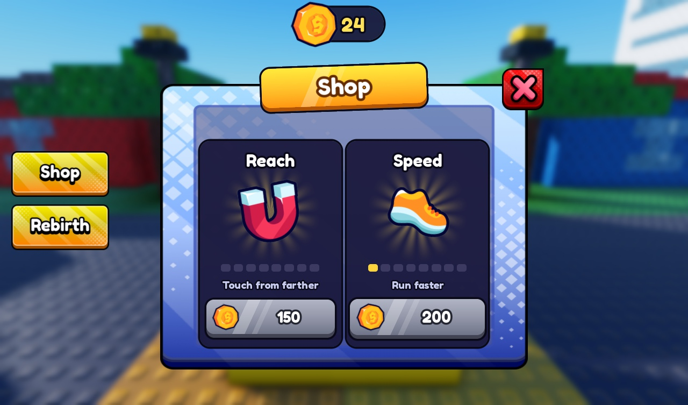
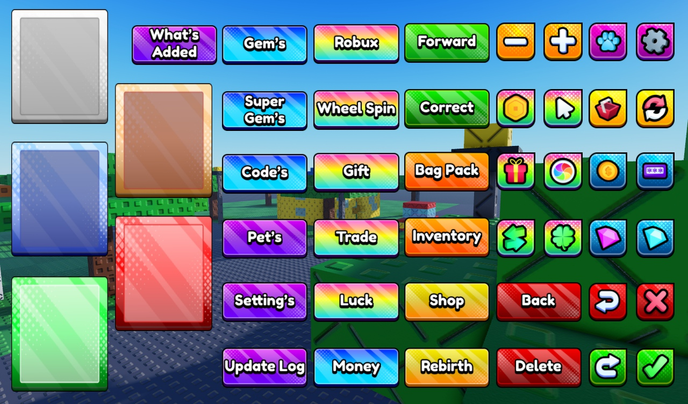

# Free UI Pack Clean Roblox

A small kit and Claude skill for using the Free UI Pack by lft_productions in Roblox Studio.

This repo holds the kit, the rules and two previews. Besides placing the pack's buttons, the kit models what the pack lacks: a coin counter, windows with a title banner, item cards, price buttons and toasts. It doesn't contain the pack's button scripts: insert the pack into your place first, then follow `SKILL.md`.

The pack's images, sounds and effects belong to lft_productions. Their license terms have not been checked.
